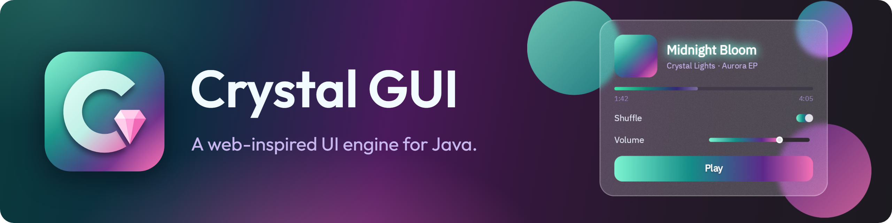
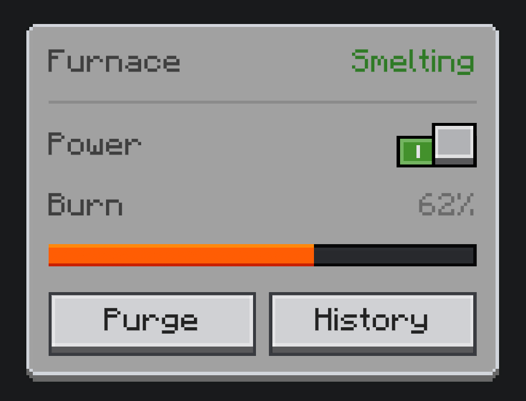

<div align="center">



<sub>The music player in the banner, with its frosted glass backdrop and surrounding circles, is a real Crystal GUI interface, built in its UI Builder: open <a href="docs/banner/banner.cgui"><code>banner.cgui</code></a> to see how it's made.</sub>

DOM and shadow roots · A real CSS cascade · Flexbox and grid · Server-driven UI · A code editor and workbench

[](https://github.com/CrystalGraphics/CrystalGraphics)
[](docs/CGUI_BUILD.md)
[](docs/CGUI_SETUP.md)
[](COPYING.LESSER)

</div>

---

CrystalGUI brings the way the web builds interfaces to Java: a node tree with shadow roots, stylesheets with selectors
and transitions, flexbox and grid layout, and a widget set that runs all the way up to a code editor, a node graph and a
windowed desktop. Build a UI for your own application or your Minecraft mod, style it with CSS, and serve it from a
server to every player who opens it.

Under the hood, each frame cascades styles, lays the tree out once and records its painting off the render thread,
drawn through [Crystal Graphics](https://github.com/CrystalGraphics/CrystalGraphics) on Vulkan or OpenGL, which also
renders all of its text and fonts. A server builds and sends UI trees with no graphics and no fonts at all. The core
names no Minecraft, loader or GL type, and it ships for Minecraft as **one jar** for every loader and version, plus an
optional language jar.

## Features

### The engine

- **DOM** — a node tree with shadow roots, events that capture and bubble, focus, and a top layer for menus and popovers.
- **CSS** — a real cascade: tag, class, id and pseudo-class selectors, custom properties, transitions and transforms.
- **Layout** — flexbox and grid through [Taffy](https://github.com/DioxusLabs/taffy), the layout engine behind Dioxus and Bevy.
- **Painting** — rounded boxes and borders, gradients, nine-slice sprites and a full SVG renderer, recorded off the
  render thread.
- **Text** — fonts and text rendered by [Crystal Graphics](https://github.com/CrystalGraphics/CrystalGraphics):
  shaped by HarfBuzz, drawn as MSDF glyphs that stay sharp at any size, generated off-thread, with system font fallback.
- **Themes** — a theme and an editor colour scheme, chosen independently, built from one token vocabulary.

### Widgets

- **Controls** — buttons, checkboxes, switches, sliders, text and search fields, dropdowns and a colour picker.
- **Structure** — tabs, split views, scrollers, dialogs, menus, popovers and tooltips.
- **Collections** — lists, tables and trees that stream large data from a server rather than holding it.
- **Graphs and canvases** — a node graph, a canvas, and drag and drop.

### Server-driven UI

- **One class is the whole UI** — its widgets as fields, its structure, and what the server does with each input.
- **Projections** — state the model-to-screen binding once and the engine sends only what changed.
- **Cheap to open** — descriptions are content-addressed, so reopening a UI costs one small packet however large it is.
- **Server-safe** — a dedicated server builds UI with no GL context and no fonts, and never takes the client's word for
  what it is allowed to do.

### Editor and workbench

- **A text editor** ported from VS Code: cursors, folding, find and replace, completion, diagnostics and diffs.
- **Languages** — in the optional language jar: Java through ECJ (errors, completion, quick fixes and Run),
  JavaScript through Rhino, and tree-sitter grammars for colouring.
- **A workbench** — docking tool windows, a project tree, Problems and an extension API for panels, file types and
  commands.
- **A desktop** — windows that stack, drag, resize and minimise with animation, a taskbar with live previews, and
  Mod+Tab.

### Platform and tooling

- **Every loader** — Forge 1.7.10–26.3, NeoForge 1.20.2–26.3 and Fabric 1.14.4–26.3, from one jar.
- **Frame Profiler** — CPU zones, GPU time and per-frame captures in game, exported to Perfetto.
- **The GL debug harness** — any UI in a window in seconds, with no Minecraft.

## Getting started

Add the repository to your `settings.gradle.kts` and the plugin to your mod's `build.gradle.kts`:

```kotlin
// settings.gradle.kts
pluginManagement {
    repositories {
        maven("https://dl.cloudsmith.io/public/crystalgraphics/crystalgraphics/maven/")
        gradlePluginPortal()
    }
}

// build.gradle.kts
plugins {
    id("com.crystalgui") version "0.0.1"
}
crystalgui {
    minecraft("1.20.1", "forge")   // or ("1.21.1", "neoforge"), ("1.20.1", "fabric")
}
```

Players install CrystalGUI and Crystal Graphics as mods of their own, and yours depends on them. Other toolchains, one
jar for several loaders and building against a checkout are all in [Setup](docs/CGUI_SETUP.md).

## At a glance

A furnace's control panel: a power switch, a burn bar and a purge button. The whole UI is one class, its server half
and its client half; `FurnaceData` is your own furnace object, which the panel is a view of.

```java
public final class FurnacePanel extends UIElement implements Networked<FurnaceData> {

    // The panel's id on the wire, and how to make one. Opening a panel names this.
    public static final UiType<FurnacePanel, FurnaceData> TYPE =
            UiType.of("mymod:furnace", FurnacePanel::new);

    // Each widget field is a part of the panel: left null, it is created for you,
    // and the client finds it again by the field's name.
    public Switch power;
    public ProgressBar burn;
    public Button purge = new Button("Purge");      // a widget that takes arguments is written out

    // Runs once on the server: what the panel holds, top to bottom.
    @Override
    public void build(FurnaceData furnace) {
        append(new UIText("Furnace"), power, burn, purge);
    }

    // Runs once on the server: what the panel does.
    @Override
    public void serve(FurnaceData furnace, ServerScope io) {
        // When the player uses a widget: io.on(widget, event of what happened, what to do).
        // Switch.TOGGLE is an event that carries the switch's new state, so `on` arrives as a Boolean;
        // ctx says who did it (ctx.viewer() is the player).
        io.on(power, Switch.TOGGLE, (ctx, on) -> furnace.setRunning(on));
        io.on(purge, Button.ACTIVATE, ctx -> {                          // a press carries nothing
            furnace.purge();
            io.notify("purged", null);                                  // a message of your own to the client
        });

        // What the player sees: io.project(widget, which of its values, where it comes from).
        // The engine reads furnace.burnFraction() each tick and sends it only when it changed.
        io.project(power, Switch.CHECKED, furnace::isRunning);
        io.project(burn, ProgressBar.FRACTION, furnace::burnFraction);

        // A question the client may ask, answered here: io.onCall(name, (args, respond) -> ...).
        io.onCall("history", (args, respond) -> respond.ok(io.newMap().putInt("burns", furnace.burnCount())));
    }

    // Runs on the client, each time the panel is built: anything local to this player's screen.
    // A server re-describe builds a fresh panel and runs this again, so set everything up every time.
    @Override
    public void client(ClientScope io) {
        // A control of this player's own: io.addLocal shows it, and the server never sees it.
        Button history = new Button("History");
        io.addLocal(this, history);

        // Ask the server, and show its answer when it arrives: io.call(name, args, onResult, onError).
        history.attachListener(() -> io.call("history", null,
                reply -> history.setText(reply.getInt("burns", 0) + " burns"), null));

        // A purely local reaction, at once, with no round trip.
        purge.attachListener(() -> purge.setText("Purging…"));

        // The server's own messages, here its word that the purge is done: style, sound, animation.
        io.onNotify("purged", payload -> {
            purge.setText("Purge");
            burn.addClass("purged");
        });
    }
}
```

Open it from the server, when a player right-clicks the furnace:

```java
CgProtocolConnection<Object> connection = CgNetwork.forPlayer(player);   // the player object; null if they're not connected
if (connection != null) ServerWindows.of(connection).open(FurnacePanel.TYPE, furnace);
```

And style it with CSS:

```css
/* Over the shipped Ore theme (crystalgui:ore), which draws the switch and buttons as Minecraft sprites. */
furnacepanel {                                    /* a panel's tag is its class name, lowercased */
    background: asset("crystalgui:ore", "panel"); /* a sprite from a theme's sheet */
    padding: 8px;
    gap: 6px;
}
furnacepanel text { color: #3F3F3F; }             /* Minecraft's GUI label grey */

/* Each widget's id is its field name. The burn bar: Ore's sunken track, filled in Minecraft's flame colours. */
#burn {
    height: 7px;
    border-radius: 0;
    background: asset("crystalgui:ore", "slider-track");
}
#burn::part(fill) {
    border-radius: 0;
    background: linear-gradient(to bottom, #FFE15A 14%, #FF9A1F 14%, #FF9A1F 86%, #C8360E 86%);   /* hard bands */
}
```

**Every player looking at the furnace stays in sync, automatically.** Say three players have the panel open and one
flips the power switch. `io.on` runs on the server and changes the furnace itself; on the next tick, `io.project` sees
`isRunning()` has changed and sends the new state to all three clients, so the switch flips on every screen at once.
Your code never tracks who has the panel open or sends anything to anyone: the furnace is the single source of truth,
and every open panel is a live view of it.

`client()` is optional: without it, the open alone names the panel and the client builds it. Stylesheets, client-only
UIs, nesting, long lists and widgets of your own are in [Building UIs](docs/CGUI_BUILDING_UIS.md).

<p align="center">
  
  <br>
  <sub>A furnace panel like the one above, built in the UI Builder on the shipped Ore theme with Minecraft's font: <a href="docs/furnace/furnace.cgui"><code>furnace.cgui</code></a> and <a href="docs/furnace/furnace.css"><code>furnace.css</code></a></sub>
</p>

## Documentation

[Setup](docs/CGUI_SETUP.md) · [Building UIs](docs/CGUI_BUILDING_UIS.md) · [Widgets](docs/CGUI_WIDGETS.md) ·
[Styling and painting](docs/CGUI_STYLE_RENDER_PIPELINE.md) · [Theming](docs/CGUI_THEMING.md) ·
[Workbench extensions](docs/CGUI_WORKBENCH_EXTENSIONS.md) · [Server and serialization](docs/CGUI_SERVER_AND_SERIALIZATION.md) ·
[Building](docs/CGUI_BUILD.md)

Want to contribute? Clone with `git clone --recursive` (Crystal Graphics, Taffy and the harness are submodules), run
`./gradlew :gl-debug-harness:runHarness --args="--mode=cgui-gallery"` to see every widget, and read
[`AGENTS.md`](AGENTS.md), the map of the codebase and its rules.

## License

CrystalGUI is free and open source, every line of it. You're free to use it in your own mods and applications,
commercial or not, to modify it, and to redistribute it; modpacks can include it as they like.

It is licensed under the [LGPL-3.0-or-later](COPYING.LESSER), building on the [GPL-3.0](COPYING). Projects that use
CrystalGUI can carry any license of their own; changes to CrystalGUI itself are shared under the same license. The
libraries it bundles are listed in [`THIRD-PARTY.md`](THIRD-PARTY.md).

---

<div align="center">

[](https://cloudsmith.com)

Maven artifacts are hosted for free by [Cloudsmith](https://cloudsmith.com).

</div>
